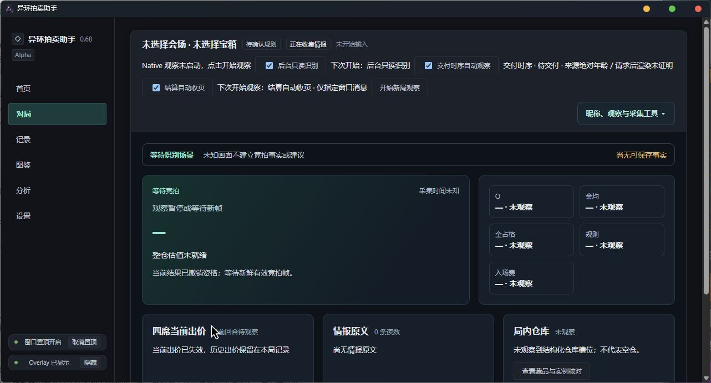

# 异环拍卖助手

为《异环》拍卖玩法提供桌面信息展示、估值计算、仓库识别和对局资料整理。产品版本为 **v0.68-alpha**，以 [core/version.py](core/version.py) 为准。

**最终产品目标（2026-10-09 更新）**：自动进入拍卖、识别估值、自动出价、结算收仓、返回并自动开启下一局。当前实现尚未完成该全自动循环；**现行开发路线和可验收状态以授权 Obsidian Vault 内的 `03-项目与工程/异环拍卖助手/README.md` → `Handoff.md` → `Decisions.md` 为准**。本公开仓库用于源码和历史技术背景，不是另一份当前交接。

**2026-10-12：开发成果统一到 `main`。** 已有 PR、收仓、估值、输入回执、PARTIAL 归档与 Main/HUD 增量统一保存，后续使用这一条主线开发。合并是版本收拢，**不表示真实全自动验收通过**：第14次收仓仍为 PARTIAL，真实游戏金额/下一局解码尚未接通，默认不授权游戏输入。**[Issue #19](https://github.com/suifracti/yihuanpaimai/issues/19) 已关闭，只有历史追溯用途；不能按其旧任务直接恢复多 Agent/PR 或声称实机验收完成。** 当前附件经既有私有 Google Drive 交接，不公开原图、日志和个人配置。无 Vault 权限的读者应将本页功能边界视为日期快照，不能据此获得操作或推送授权。

## 从 GitHub 重新取得源码

**2026-10-13：本机开发也对齐到公开 `main`。** 核对并补回远端已合入、旧本机工作分支遗漏的估值候选、报价意图及回执接线，同时保留最新收仓、等待恢复和原图回看修复。以后每次完成修改同步 GitHub；Obsidian 记录进度，不再让本机旧分支与公开主线各自推进。自查范围及未完成项见 [源码与历史对齐记录](docs/reports/2026-10-13-source-mainline-alignment.md)。

日常开发固定为：**读取远端main → 在同一主线改动 → 最小检查 → 提交推送 → 读回确认**。每个完成的小改动及时同步，不长期积攒未推送成果；程序从这份源码及其对应Host运行。旧分支/工作树保留历史，不再形成另一套活动版本。文档修改复用未受影响的构建与通过证据，不重复验收。

下载本仓库 `main` ZIP，或 `git clone https://github.com/suifracti/yihuanpaimai.git`。源码、UI 资源、轻量目录/模板、依赖锁定与 Host 构建工程在仓库内；Python 环境和 Native Host 输出需要重新安装/构建。不要使用旧候选脚本的默认10月6日 manifest 代表当前版本。

在解压/克隆后的根目录执行以下准备命令（不启动游戏）：

```powershell
py -3.10 -m venv .venv
.\.venv\Scripts\python.exe -m pip install -r requirements-desktop.lock.txt
if (!(Test-Path app/config.json)) { Copy-Item app/config.example.json app/config.json }
dotnet build architecture/v2/host/wgc_live_harness/WgcLiveHarness.csproj -c Release -o build/native-observation
```

需要 Windows x64、.NET 8 SDK、WebView2 Runtime 和 Node.js。只打开助手界面时使用已装依赖的明确解释器，避免裸 `python` 缺 `cv2`：

```powershell
$env:NTE_DISABLE_VISION = '1'
$env:YIHUAN_DATA_ROOT = Join-Path $PWD 'build/local-data'
.\.venv\Scripts\python.exe app/main.py
```

**删除旧目录前需要单独保留的本地资料**：`app/config.json`、`data/videos/`、`data/reference-crops/`、`build/` 内原图/会话/诊断证据及未发布工件。正式历史默认在 `%LOCALAPPDATA%\异环拍卖助手\data\history\异环拍卖数据.json`，自定义 `YIHUAN_DATA_ROOT` 的历史位于对应目录。它们不在公开 GitHub 中；下载源码不会恢复这些资料。被净化移除的旧截图/测试素材同样不恢复。源码恢复与本地私有资料恢复是两项不同操作。

## 界面



这是助手自身窗口的实际截图，使用空的隔离数据，禁用了视觉和总线，没有采游戏或全桌面。勾选项来自保留的本地配置，不代表模板默认值；截图不构成实机全自动通过证据。

## 目前能用什么

- 主窗口、HUD、手工字段编辑、拍卖估值计算和实验室求解器已有实现；历史资料可以查看，旧格式记录保留 LEGACY 身份。
- 仓库网格、部分格子分件、多页登记及重叠处理已有离线成果。候选框、观察组件和机器确认数都不等于准确物品总数；目录图不能单独证明身份。
- Native 指定窗口观察、后台模式、最新帧有界队列、SOURCE v2 原图保存及同图核对已有代码。慢 OCR 会跳过待处理帧，持续取帧不保证记录每条短暂情报。
- 结算自动触发、独立原图保存和窗口滚动消息已接线。当前按半视口先收图，稀疏内容或未匹配重叠不阻止继续滚；底部后核覆盖，无法证明时保留 PARTIAL。真实完整底部与连续覆盖尚未通过。
- `offline-content/2cb94b822f75` 的离线正常收页链路通过：保存、独立支持、模拟滚动回执、滚后位移、重叠及末尾覆盖可以串起来。使用生成夹具和空身份参照，**离线 COMPLETE 不等于实机全自动通过**；共同采样模型未启用到生产。

## 怎样运行

源码入口为 `app/run.bat` 或 `app/main.py`，实验室入口为 [lab/index.html](lab/index.html)。旧日常运行包不代表本次源码。

需要 Windows x64、Python 桌面依赖、WebView2、Node 求解器以及 Native Host 的 .NET 运行环境。依赖快照为 [requirements-desktop.lock.txt](requirements-desktop.lock.txt)，环境和构建背景见 [docs/desktop-environment.md](docs/desktop-environment.md)。其中旧验收范围保留历史含义，本次不重新安装或构建。

本机保留 `build/takeover_20260905/repro-venv` 开发环境。以下方式仅打开界面、禁用视觉采集，并隔离数据；**本次没有执行这些命令**：

```powershell
# 在仓库根目录执行；已有个人配置不得覆盖。
if (!(Test-Path app/config.json)) {
    Copy-Item app/config.example.json app/config.json
}
$env:NTE_DISABLE_VISION = '1'
$env:YIHUAN_DATA_ROOT = Join-Path $PWD 'build\paused-ui-data'
& .\app\run.bat
```

个人 `app/config.json` 原地保留、不入库；Git 提供 [app/config.example.json](app/config.example.json)。模板使用 Native 档案、严格来源模式，并关闭自动收页。本地旧配置可能已开启交付模式和自动收页，不能假定它等于模板。

明确开始实机观察时，才解除 `NTE_DISABLE_VISION`；用 `NTE_NATIVE_HOST_EXE` 指向从当前源码构建的 `build/native-observation/WgcLiveHarness.exe`。运行需要整个 Host 目录及依赖，不能只取 EXE。启动前核对配置、Host 身份和总线占用，不绕过占用检查或误停其他进程。

### 选项与停止

- **后台只读识别**本身不操作游戏，只观察指定窗口；最小化、窗口身份或映射失效会停止。
- **结算自动收页**是独立选项。开启后，合格结算可向指定异环窗口发送滚动消息，不激活窗口、不使用全局输入。
- 收仓前自动点击可用的**跳过动画**按钮，支持白色及点击后粉色状态；内容仍在显露时可按新画面继续点击。已有独立原图支持当前可见内容稳定时继续收仓，粉色按钮持续显示也不会令点击空转。使用指定窗口消息，不移动系统鼠标或启动报价、交易、下一局。一次回执不代表游戏已跳过，本场粉色漏识别修复的真实效果仍待验证。
- 即使跳过按钮暂不可用，顶部仍有未显露白框时也会保留原图并继续取图，白框消失后重新取得独立图片再滚动；中段仍持续收图，不因普通微变或重叠未证而停住。已漏拍的旧局内容不能从空网格补造。
- **停止采集**只停止当前收页并保留部分材料，本局不重试；自动收页仍开启时，下一局仍可能触发。取消勾选**结算自动收页**同时停止当前收页并关闭后续触发。结束观察停止观察链路。
- **不再使用16张来源／32次请求／固定70秒人工总额度。** 按真实结算、用户停止和有界无进展恢复结束。发送成功不等于实际滚动，滑块到底也不能单独证明像素覆盖完整。

## 未完成与已知问题

1. WGC 来源时间未来值在游戏和自建 DXGI 窗口复现，问题未修复。严格模式保留拒绝；交付时序只证明近期交付，不能证明请求后渲染或来源绝对年龄，仍有上游迟交／重放风险。不能运行中换模式或自动降级。
2. 最新收仓路径先收图后核覆盖，普通无帧等待已修复；新版本完整真实底部仍待实机。按钮文字、灰色外观、OCR 一致或滑块位置不能单独证明完整覆盖。
3. 第五张后的续取修复已有实机通过结论；它不证明稳定页、真实自动滚动、完整收页、返回大厅及自然下一局已经通过。
4. 未证明跨视口对应时，不能直接累计数量或总价。裁切物件只算片段；品质、身份、数量及正式记账仍受原确认门槛约束，原图先保存不构成正式事实。
5. 已知素材的项链／卡丁车拆件及 57px 纵向周期修复已整合，白框最终修复也在当前主目录；仍有局部 X 偏移、品质块未知及未见场景识别边界。这些局部修复不代表所有仓库物品可用。

## 保存与恢复

源码、配置模板、测试、小型夹具及来源说明保存在 Git。个人配置、数据库、原图、录像、大型日志、编译产物、未批准候选资料和三个旧 worktree 留在本机，不强塞 Git，也不删除。

- 正式历史默认在 `%LOCALAPPDATA%\异环拍卖助手\data\history\异环拍卖数据.json`；隔离运行使用 `YIHUAN_DATA_ROOT`，不能用测试数据覆盖正式历史。
- 工作素材在 `data/videos/`、`data/reference-crops/`，证据及开发环境在 `build/`，旧运行包在 `dist/` 等既有目录。
- [暂停基线与恢复说明](docs/reports/2026-10-07-paused-baseline.md) 列出源码提交、Host 指纹和恢复顺序。本机 `build/paused-baseline-20261007/freeze.json` 记录最终 SHA 与运行文件指纹；私有清单不对外分发。

恢复前先核对 Git 提交和本地材料，不执行 reset、clean、整树覆盖或删除旧候选。Git 单独不能恢复未入库的环境和原始证据。

源码仓库为 [suifracti/yihuanpaimai](https://github.com/suifracti/yihuanpaimai)，**已于 2026-10-08 公开**。已清洗同一仓库的 21 个分支／标签引用，保留名称。GitHub 旧 SHA 缓存和旧 PR 引用尚未清除，历史游戏 UID／昵称仍可能被看到；仓库所有者明确接受这一残留风险后授权公开。支持清除申请未提交，不能宣称服务器上的旧材料已彻底移除。

本机完整旧历史只作私有恢复，不应直接推送、merge 或 mirror 回远端。主目录保留 `codex/consolidate-workspace` 旧历史及 `origin` 禁用推送设置；当前工作 `main` 使用公开净化后的历史。普通提交后仅推送当前主线：`git push https://github.com/suifracti/yihuanpaimai.git main:main`。源码、个人配置和原始材料的保留边界不变。

清洗后主线的可达历史不包含被移除的个人标识游戏原图和 OCR 记录；这不包含仍残留的旧 SHA 缓存和 PR 引用。相关旧回归素材仍在本机，公开克隆不能据此宣称完整回归通过。个人配置和私有恢复材料不上传；当前没有完成实机全自动验收或发布运行包。
