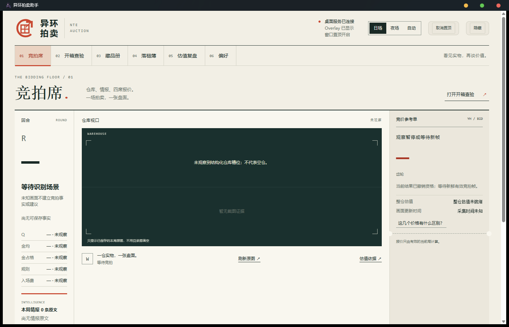
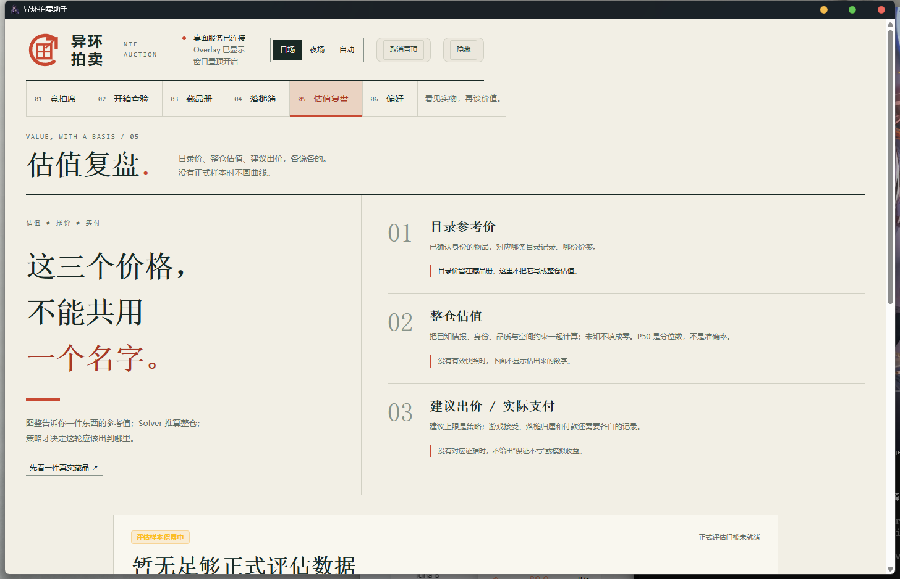
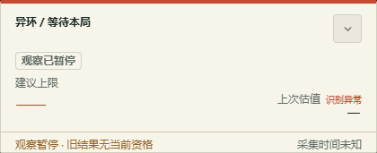

# 异环拍卖助手

> 为《异环》拍卖玩法制作的**非官方 Windows 桌面助手**：把竞拍信息、仓库观察、藏品识别、估值参考和对局回看集中在一处。

**当前版本：** `v0.68-alpha`（以 [`core/version.py`](core/version.py) 为准） · **阶段状态：** 2026-10-21 已实测连续三局「出价／纯观察／出价」流程。逐局数据完整、正常产品开关和连续十局验收尚未完成，**这不是正式发布版**。产品要求见 [`docs/design-principles.md`](docs/design-principles.md)。

## 🎴 看看界面

### [查看六页完整交互预览 →](docs/demo/全页面交互预览.html)

演示采用「**拍卖图录**」设计：米白、墨色和朱红的**日场**，深蓝绿与暖白的**夜场**；竞拍席、开箱查验、藏品册、落槌簿、估值复盘、偏好六页可切换。包含图鉴搜索/筛选、藏品档案、主题切换、图片查看及悬浮票等演示交互。

**如何体验：** 在 GitHub 查看上述文件后，建议下载或克隆**整个仓库**，用浏览器打开 `docs/demo/全页面交互预览.html`。页面图片引用本仓库的 `1.4更新/` 公开参考资源；**只单独下载 HTML 可能缺少部分图片**。仓库暂未启用 GitHub Pages，因此 GitHub 文件查看页不是在线运行的演示站点。

这是一份**经过脱敏的只读设计演示**：不连接游戏、不操作鼠标键盘、不写入真实历史、不发起竞价，也不等于当前 Windows 主程序的全部功能。完整版原始设计与工程交接材料保留在项目的私有附件目录中。

### Windows 实际截图

这些图片取自 **2026-10-16 的 Windows 主窗口/HUD UI 验收**。当时使用只读或隔离数据，并非游戏中的实时自动竞拍成果；藏品册的图片与价格属于图鉴参考资料。

| 竞拍席 · 日场 | 藏品册 · 夜场 |
| :---: | :---: |
|  |  |
| **藏品册 · 日场** | **估值复盘 · 日场** |
|  |  |

**悬浮票 · 日场（收起）**



完整页面和主题交互请使用上面的 [只读 HTML 演示](docs/demo/全页面交互预览.html)；演示数据、UI 截图与真实游戏识别结果应分别看待。

## 项目包含什么

| 页面 / 能力 | 用途 |
|---|---|
| **竞拍席** | 集中查看回合、情报、仓库视口、四席出价和有依据的竞价参考 |
| **开箱查验** | 保存结算原图、按件审阅藏品与候选，区分完整覆盖、身份确认和未知 |
| **藏品册** | 按名称、品质、类型、规格浏览参考资料与角色资料；目录价格不等于成交价 |
| **落槌簿** | 回看历史局次、原图、估值和结算，支持已有的导入、导出及记录管理 |
| **估值复盘** | 将目录参考价、整仓估值、建议出价与实际结果分开解释 |
| **偏好与悬浮票** | 日场 / 夜场 / 跟随系统、窗口与 HUD；HUD 为独立原生窗口 |

程序现有 Python 视觉/主界面、JavaScript 求解器、C# Native Host、原图及历史存储链路。正式 Windows 版已完成六页主窗口集成、日夜主题同步与若干交互验收；**浏览器演示的互动成功不代表游戏实机成功**。

## 当前状态与限制

- **一局结束后到底停在哪（2026-10-22）**：不是保存失败，是“回大厅→下一局”被拦。run-10 的草稿是自动写的：00:08 结算进草稿，00:14 收页 COMPLETE（20 张）＋细化 COMPLETE，00:18:45 合并落盘（审阅单元 33、16 页、identity review v2、occupancy），全程没点保存。停住的直接原因是 `verification_run_current`：`scene==LOBBY` 且已见满模式数就 `stopped`，于是 `matchesDone=0`、不派发 `ReturnLobby`/`StartNextMatch`。另外原生试运行链路只写 `live-trial DRAFT`（`save_draft` 强制 DRAFT + live-trial，界面也标“未进入正式 History”），`FINALIZED` 只由视觉管线的 `auto_archiver.archive_match` 产生，原生实时局不走那条。手动关进程发生在整轮已自行 `stopped`、桌面又进了新一局之后，只为结束会话看证据；草稿在那之前已经写完。**M4b 验收按用户 2026-10-22 决定：不再要求局内显露的真实案例，其余条件满足即通过，局内显露等接上三种显示仪器后另测。**
- **run-10 实机复验：超时断点已通（2026-10-22 凌晨）**：用修好的引擎重开一局出价局，`run-identity` 记 `head=26cbead`、宿主 `3c424088`。事实为 `中级场 · 珊瑚场`、`美食宝箱`、`fieldCondition=standard`、q=15、金均 60556、紫数 3，求解器给出 `solverStatus=valid`、`partial_shadow`（1/9 state）、结构中心 616888，`stderr` 全程 0 次 `Node shadow compute timed out`。5 回合每回合都派发并成交价记录在座次里：第 1 回合 325868，第 2–5 回合 754575；结算 `status=verified`、`clearingPrice=777777`、`actualTotal=920937`，赢家是对手 `公鸡开大巴`，`isSelfWinner=false`；每回合 4 席，收页 20 张 COMPLETE、细化 COMPLETE（约 6 分钟）。同一局 `WAITING_WAREHOUSE_SAVE` 收尾与 run-8 相同（进程在收藏环节被手动关闭），记录仍是 DRAFT，没有回填。
- **求解超时的定性（2026-10-21 深夜）**：不是实机抢资源，是这组事实下枚举太大。用 run-9 保存的事实（q=16、金均 93022、goldGrid=60、totalGrid=116，紫/金/低阶计数全未知、0 条历史）在干净 Node 上离线单跑，从 Main 触发的同一条路径要 13.8–15.8 秒，而预算只有 8 秒；CPU 采样落在 `solveExactStatesSync` 的黄金 DFS，单次求解约 2880 万个节点。原因：紫色数未知 → P 取 0..16 与 G 全组合；`floor` 均价窗口只有 G 个整数宽，原有的“剩余数量最小/最大金额”剪枝几乎不筛；`wholeGridPossible` 只在叶子按 goldGrid 把关。另有一处纯浪费：`totalItems` 未知时低阶三色仍建“数量:面积”印章集，而答案只用到面积。修法没有动超时和阈值：DFS 下降时用 `jointTables` 的（数量, 格数）→最小/最大金额表强剪枝；未知总数时只合并可达面积集。同一请求 13.8s → 0.73s，56 个 exact state、candidateGs [6..12]、candidatePs [0..10] 全部不变，整份结果除 `solvedAt`/`capturedAt` 外逐字段一致；新增 `test_sparse_gold_grid_facts_keep_their_states` 钉住这组事实。引擎文件变了，`test_solver_context_compatibility_v1` 的引擎哈希已更新；同文件里 `solver_core`/`shadow_profile` 两个固定值在 HEAD 上本就不匹配（`solver_core` 实际 55a177… vs 固定 1ec8dc…，`3b279fb` 改过文件后没跟上），不是本次引入，已一并改成按 LF 归一化比对并把固定值更新到当前内容。
- **细化中断可续（2026-10-21 深夜）**：`placementRefinementPending` 现在只要 refinement 处于 QUEUED/RUNNING 就保持为真，后续 manifest 写入不会清掉；启动时 `resume_pending()` 对 QUEUED/RUNNING 的作业以 resume 租约重新入队（与结算归档 PENDING/PROCESSING 的恢复同一套做法），刻意取消的仍保持 CANCELLED。`test_interrupted_refinement_is_resumed_on_the_next_start` 实测 RUNNING → 新进程 → 新 jobId 的第二进程启动。
- **M4b 稀疏重叠缺口已定性并修好（2026-10-21 夜）**：不是缺图，是证明方法过严。观察局 51 张原图里 20→21 是揭示期真实约 211px 的大跳，色度分数 0.868–0.948，旧实现只比梯度得到 0.676/0.651/0.74，低于 .80；同一局滚动条在揭示前不动，`TerminalContinuity` 只拿到 1 个标定样本（旧实现要求 ≥2）；揭示期间相邻帧也不是像素静止，`stationary_support_proof` 全部拒绝，覆盖链因此断开。`ec0cb10` 改成“一次内容匹配双侧约束 + 同视口证明”，阈值未降。离线重放 15 步全部 VERIFIED、Host 覆盖 COMPLETE，故意删掉 20 页仍为 PARTIAL；原实机 PARTIAL 记录保留，没有回填。
- **跳过动画“没反应”的真实原因（2026-10-21 夜）**：点击没有失效，是实机跑的是 15:37 的旧宿主 `b5d344d0`——回执里仍带 `pressDurationMs: 80`，该字段在 `3aee32b` 已随窗口消息一起删除；修好的宿主是 `0f7dc6fa`。run-9 用新宿主实测：1 次点击、1.55 秒后揭示结束（run-8 旧宿主是 18 次点击、27 秒），揭示期保存页从 18 张降到 2 张，收页 21 张 COMPLETE、细化 COMPLETE。此后宿主收敛为唯一固定位置 `architecture/v2/host/wgc_live_harness/bin/Release/net8.0-windows10.0.19041.0/WgcLiveHarness.exe`，run.bat、打包和 Main 都只取这里，“选最新构建”的逻辑已去掉，启动日志仍记 DLL SHA-256。证据见 `build/m4b-20261021/skip-real-click/stale-host-proof.json`。
- **同局记录（2026-10-21 夜）**：run-8 竞拍局 `replayfile_79c95fa9…` 已把 `venue=中级场·珊瑚场`、`fieldCondition=标准对局`、q=18、金均 40836 送进求解器并 `bid CONFIRMED 403365`；结算 450000／533651／83651 为 verified 最终值，4 回合各 4 席，同局记录同时含情报 q=18 与仓库审阅包 42 个单元／14 段。run-9 也是出价局（`mode=bid`、入场已缴费、补仪器 `UseGoldAverage CONFIRMED`），事实齐全（q=16、金均 93022），但影子计算连续 6 次 `Node shadow compute timed out after 8.0s`，`solverStatus` 整局停在 `pending`、`shadowGen=0`，所以每回合的 `SNAPSHOT_BINDING_INVALID` 只是症状；超时的定性见上面第一条。M5 未开始。
- **细化在后台跑（2026-10-21 夜）**：run-9 的仓库细化 22:56:55 开始、23:02:39 完成（344.8 秒），22:57:53 已经进入下一局，返回和开局都没有等它。细化是一个 daemon 线程起独立子进程，每局一个 `warehouse-intake/<session>.json`，结果要过 inputFingerprint、jobId、RUNNING 状态三道校验才合并，run-7 两局分别 40／24 个单元，没有串局。进程退出仍不等细化；RUNNING 时退出会在下次启动按上一条续上（这四个局都是在退出前跑完的）。
- **M4b 定向复跑（2026-10-21 夜）**：鱼藏品去重 `test_warehouse_placement_resolution_v1` 8/8 通过（216 秒，含 `test_real_once10_cut_fish_tail_is_clipped_but_adjacent_complete_items_are_full`）；此前因缺私有帧被跳过的 `test_live_rule_footer`，用 run-u 真实帧 `NTE_REAL_AUCTION_REPLAY` 补跑 5/5 通过，输出 `REAL run-u rule/box -> engine -> Main -> Solver PASS [362201.4, 1291928]`。没有跳过，也没有改阈值。
- **此前 M4b 复验（2026-10-21 白天）**：运行源码 `34e9e15`，出价/观察各一局，分别55/43张SOURCE、17/12次真实滚轮，均保存真实BOTTOM、生产收页及覆盖结果COMPLETE；两局停止回执确认Host退出，没有额外入场。出价局金均40414在剩36秒读出，但会场/箱名已映射后，`fieldCondition`仍为空，求解准入报“缺失场地规则”，未发送报价。两局均第一回合成交，没有局内显露身份的有效正例；不能宣称报价截止或M4b全项通过。
- **此前 M4b 实机失败（2026-10-21）**：出价局被动作之间残留的焦点历史阻挡，未取得金均和出价确认；已用原故障序列修复。观察局保存了三回合四席报价和情报，金均在第一回合剩43秒时读出，局内画面没有显露具体藏品，不能冒充身份验收。结算只留下两张未合格原图，滑块变化后被旧TOP条件误停；完整仓库识别未完成。验收脚本仅按成功局数计数，又误进入一局观察，已停止并保留19张部分原图；未新增报价或使用仪器。现改按实际观察到的局次限制试验，返回未知也停，不再借采集失败追加开局。
- **本轮离线修复**：已回到正确游戏窗口时不再因旧焦点计数永久拒绝动作；揭示时仓库位置改变继续保存/观察，缺顶部支持仍保留PARTIAL。跳过动画增加80毫秒按压再释放，真实效果待验。Native窗口消息不要求前台，明确“停止收仓”关闭租约并同时停止自动串联、恢复主窗口；Esc和普通窗口切换不接这个停止入口。定向检查和Windows构建通过；M4b未通过，因此M5桥接动作和产品状态尚未开始。
- **最新实测（2026-10-21，M4 连续流程）**：源码 `2a0a2d7`、正常 Main 配合实验开关及 Native Host，在 `build/m4-20261021/run-8/` 完成三次入场费用确认、三局结算保存与自然返回，并连续进入下一局。两局出价共四笔 `CONFIRMED`（311847 三笔、387554 一笔），纯观察局没有补仪器、使用仪器或出价；三局结束后由验收脚本停止，Host 退出、Main 恢复，没有进入第四局。
- **原图和覆盖的实际结果**：三局分别保存 51／51／30 张 SOURCE、滚动 19／19／6 次，已核对原图哈希、对应局次和历史记录均可读。原实机出口为 `PARTIAL / BOTTOM_SAVED_COVERAGE_PENDING`。随后用这三局原图修复了“尾部仍露物品就拒绝网格测量”及整数位移无法匹配小数滚动的问题；不改匹配分数，公共空网格仍须在两段原图中实际对齐。离线回放三局采集流程及 Host 保存账本均为 `COMPLETE`，故意缺页仍为 `PARTIAL`；没有修改旧实机结果，也没有新增一场实机。
- **M4b 接线与剩余工作**：已恢复连续拍卖模式下既有后台局内识别，不阻塞竞拍帧；沿用候选、OR 和物理实例规则。四席报价按回合保存，未知不填零，换回合不串价，经现有历史保存、冷读和 Main 回看显示检查通过。这两项离线接线不等于 M4b 全部实机验收；逐回合完整估计与结算对照仍需核对。金均及紫数已实测（紫数 3 进入 Solver 后更新报价，`build/m4-20261021/run-7/`）；显示藏品／轮廓／品质仪器及 M5 产品开关尚未接入。普通双击启动仍不等于启用实验自动拍卖。
- **Esc 停止勘误**：此前 `USER_STOP` 是在 Computer Use 返回中断提示后由验收脚本发出的，不证明用户按了 Esc。工具只留下中断标记，缺少按键来源记录，无法归因给用户或游戏。另已修复 Native 监听将外部注入输入误记成人工接管的问题：注入单独记录，真实人工输入仍能停止。

以下 2026-10-20 及更早条目保留为历史截点；当前进度以上方记录和 Obsidian Handoff 为准，不重复实施旧断点。

- **已具备的基础**：指定窗口观察、图像/OCR 处理、结算原图保存、仓库滚动与部分覆盖分析、目录参考和具体藏品审阅、历史读写/回看、估值求解与界面/HUD。real-once-10 已写入同局剩余估值：43 件已确认，目录小计 935775，剩余范围 0–0。梦中萤记为缺素材，梦中茧记为 METADATA。
- **已有的实测边界**：2026-10-20 实机目录 `build/goal-20261019-b/match-5` 的仓库收齐是 `COMPLETE`（`finalizationReason` 为 `COMPLETE`，保存 36 页，滚动 6 次，`coveragePending` 为空）。观察因 `COLLECTION_COMPLETE` 停止，Host 进程退出已确认。match-1 到 match-4 仍是 `PARTIAL`，目录和原图保留。match-5 的结算记录没有 `remainingValuation`。回看读的是 real-once-10 已经写入的同局估值，没有重跑 896 秒识别。
- **新增接线与离线检查（2026-10-20）**：已加入基于场景锚点的游戏控件解码和现有 Host 票据发送接线（`bedbca3`），以及 Python 出价、返回、下一局状态循环（`3c30544`）。这些路径需显式启用 `NTE_DOMAIN_ALLOW_GAME_INPUT=1`、`NTE_SCENE_ANCHOR_DIR` 和 `NTE_DOMAIN_LIVE_LOOP=1`，普通启动不等于开启它们；未连接时仍拒绝发送。后续修复了观察卡顿、回合来源及求解准入使用同帧 engine 快照的问题，最新代码提交为 `f4c97912d4cfeaae3985a7bd35892da54c172c2a`。该提交的 [离线 CI](https://github.com/suifracti/yihuanpaimai/actions/runs/39338004872) 两个 job 均成功。
- **尚未完成的目标**：实机「出价 → 结算收仓 → 返回 → 自动进入下一局」仍未跑通。最新已保存尝试 `build/goal-20261019-c/match-12/watch.log` 在结算时以 `settlement-without-send` 结束：日志记录金均 29739、Q=22、仪器使用已观察到，但仍为 `estimate=None`、`phase=None`，没有成功发出的出价。尚不能仅凭这份监控日志确定最终根因；下一步应复用本局材料离线定位求解结果到发送状态的断点，不能将新增接线或离线 CI 通过当作实机闭环通过。此前 match-1 到 match-11 的材料保留，不为收尾再开一局。
- **关于费用与风险**：估值、目录价、报价建议、游戏实际付款和收益是不同数据；证据不足时应显示未知，不能推断保本或获利。

Grok 最后对仪器按钮、选择仪器后还须点击“使用”、以及状态字段位置的排查，原先留在临时验收脚本中。可复用的只读部分已整理为 [`tools/inspect_saved_auction.py`](tools/inspect_saved_auction.py)：传入 `--image`（可重复）或 `--state`，即可检查已保存截图的按钮区域和状态字段，不启动游戏、不采帧、不点击。原图复核可区分第9局的仪器区域与第12局的“使用”区域；这些测量不是正式输入坐标，也不表示仪器点击已接入正常 Main。完整临时实机脚本及私人原图仍保留在本机，没有混入产品自动启动。

最终产品方向仍是 **进入拍卖 → 识别与估值 → 有界出价及游戏确认 → 结算收仓 → 归档 → 返回 / 下一局**。目前不能把这些目标当成已交付能力。

## 在 Windows 从源码运行

需要 **Windows x64、Python 3.10、WebView2 Runtime、.NET 8 SDK**；求解器相关工具还会用到 **Node.js**。克隆源码并准备桌面依赖（首次安装需联网）：

```powershell
git clone https://github.com/suifracti/yihuanpaimai.git
cd yihuanpaimai
py -3.10 -m venv .venv
.\.venv\Scripts\python.exe -m pip install -r requirements-desktop.lock.txt

if (!(Test-Path app/config.json)) {
    Copy-Item app/config.example.json app/config.json
}

dotnet build architecture/v2/host/wgc_live_harness/WgcLiveHarness.csproj -c Release
```

Host 只有一个固定位置：`architecture/v2/host/wgc_live_harness/bin/Release/net8.0-windows10.0.19041.0/WgcLiveHarness.exe`。`run.bat`、打包和 Main 都只从这里取；不再保留 `build/native-observation` 之类的副本，启动日志会记下该 DLL 的 SHA-256。

**仅浏览 UI（不启动识别、隔离测试数据）**：

```powershell
$env:NTE_DISABLE_VISION = '1'
$env:YIHUAN_DATA_ROOT = Join-Path (Get-Location) 'build\readme-ui-data'
.\app\run.bat
```

正常入口为 [`app/run.bat`](app/run.bat) / [`app/main.py`](app/main.py)。若启用实际窗口观察，需使用本机有效配置和与源码对应的 Native Host，并按当次许可操作；不要直接把 UI 预览当成运行程序。更多环境说明见 [桌面环境文档](docs/desktop-environment.md)。

## 数据、源码与后续维护

GitHub `main` 是源码主线；**个人配置、正式历史、游戏原图、运行日志和私有测试证据不随公开仓库提供**。本地 `app/config.json`、`data/videos/`、`data/reference-crops/` 及 `build/` 里需要保存的资料，请勿因为重新克隆而清理。隔离数据可通过 `YIHUAN_DATA_ROOT` 指定。

本项目的**最新实际进度与长期决定**记录在有权限的 Obsidian Vault：`03-项目与工程/异环拍卖助手/README.md` → `Handoff.md` → `Decisions.md`；此公开 README 只说明可供外部理解的项目现状。已关闭的 [Issue #19](https://github.com/suifracti/yihuanpaimai/issues/19) 只用于历史追溯，不是当前待办清单。


*本项目非《异环》官方产品。游戏名称及参考图像相关权利归原权利人所有；演示素材不代表官方授权或实时游戏事实。*
